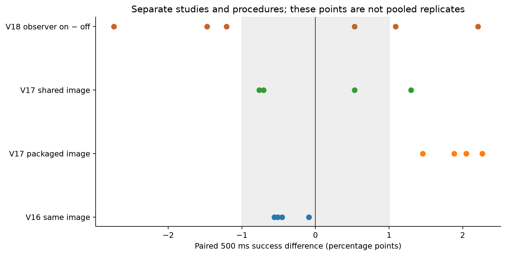

# Overnight analysis: what remains after V18

Prepared overnight 2026-10-04–05 from retained data only. No new benchmark, kernel attachment,
service rebuild, host-setting change or performance treatment was run.

**Recommendation:** test one existing control next: reduce CPU workers from four
to one while keeping GOMAXPROCS=1, the exact executable, quota, period and offered
arrivals fixed. Include two identical four-worker arms to measure repeatability
under the same new procedure. The implementation-ready proposal is
[V19](../../../docs/runtime_io_v19_plan.md).

## What this analysis establishes

The untraced V18 arm retains a substantial delay after the main computation
finishes. It is neither explained entirely by an uninterrupted whole-service
freeze nor predominantly by response delivery after handler resume. Queue buildup
and this completion-to-resume interval coexist during the high-rate burst.
The next useful question is whether a simpler worker limit removes that interval
and improves deadline success, or merely moves waiting into the computation queue.

These are scoped conclusions about the instrumented stock service already used
in these studies. Its completion marker precedes event storage, result publication
and handler execution. Publication and goroutine runnable readiness remain
unobserved. There is still no established scheduler defect or new policy result.

## Integrity and accounting

The independent V18 verifier rechecked preparation, qualification, all twelve
accepted raw trials, source/executable identities, cleanup, paired offered vectors,
the original report and exported rows. Its decision remains
`effects_outside_margins`; `observer_cost_qualified=false`.

The new analysis joined all **81,516** offered requests to their worker and handler
records. Every request was successful and finished within one second. Each trial
offered 6,793 requests. Stage ordering, recorded duration identities and the
per-request end-to-end budget were checked. Logical-backlog areas were independently
checked against summed interval durations. Interval-union queries were tested
against a discrete representation, including overlapping intervals and empty gaps.

Client/server direct clock brackets are **111.358–156.863 microseconds** wide.
They are tighter than the earlier composed kernel/client/server brackets. No
timestamps were added, moved or silently clipped. Quantiles in this report and its
new CSVs use nearest rank; original frozen screen metrics retain their original
definition. Every data point is descriptive; the six trial pairs, rather than
81,516 requests or 72 cycles, are the experimental units.

For 6,737 requests the lower resume-to-client bound extends below zero while its
upper bound remains nonnegative. This is clock-bracket uncertainty near a short
interval, not evidence of negative physical latency. Those lower endpoints remain
in the CSV; the table below uses upper bounds.

## Deadline accounting

All counts below use the scheduled-arrival 500 ms deadline and all offered requests.
Clock-bound ambiguity is explicit.

| Outcome | Observer off | Observer on |
|---|---:|---:|
| Offered | 40,758 | 40,758 |
| Timely successful | 31,029 (76.13%) | 30,921 (75.86%) |
| Computation certainly after deadline | 6,143 | 6,347 |
| Computation boundary ambiguous | 4 | 7 |
| Computation certainly before; handler certainly after | **3,565** | **3,474** |
| Handler boundary ambiguous | 10 | 5 |
| Handler certainly before; client completion after | 7 | 4 |
| Sum of misses | 9,729 | 9,837 |

The untraced crossover class is **36.64% of misses**, or 8.75% of all offers.
Its count is 567–609 in each individual off trial. **1,576** such responses have
at least 50 ms of certain completion margin before the deadline. That is a
consequential interval to investigate, not a recoverable-response estimate.
Changing scheduling or concurrency also changes subsequent queue history.

The earlier review counted **3,518 off / 3,428 on** crossovers using the looser
composed bounds. This reanalysis counts **3,565 / 3,474** with the existing direct
client/server anchors. The differences of 47 and 46 are better classification of
existing observations, not additional requests or a changed deadline. Both
versions are retained in the new request CSV.

For the off-arm crossover class, the median completion-to-resume gap is
**94.90 ms**. Every one of these **3,565** gaps contains a strictly interior
worker-start marker for another job; the median is **14** such starts, range 1–32.
All **15,928 off-arm gaps longer than 50 ms** also contain another job start.
These user-code observations alone reject uninterrupted whole-service suspension
as the entire gap. They do not show that the particular HTTP handler was runnable,
that publication had occurred, or that quota pauses contribute nothing.

## Where wall time goes

Pooled means and quantiles are descriptions, not estimates from independent
requests. Stage percentiles must not be added into an end-to-end percentile.

| Measured interval, off arm | Mean | Median | p99 |
|---|---:|---:|---:|
| Scheduled offer to handler entry, upper bound | 86.97 ms | 108.18 ms | 284.90 ms |
| Entry to admission | 0.017 ms | — | — |
| Admission to worker start | 139.42 ms | 94.95 ms | 480.35 ms |
| Computation wall time | 18.99 ms | 3.16 ms | 155.46 ms |
| Computation completion to handler resume | 38.12 ms | 4.85 ms | **161.59 ms** |
| Handler resume to client completion, upper bound | 0.266 ms | 0.184 ms | 0.750 ms |
| End-to-end | 283.65 ms | 296.83 ms | 751.54 ms |

Scheduled-to-entry includes client dispatch, transport and HTTP/runtime processing;
it is not a ready-queue duration. Computation wall time includes scheduling/quota
interruptions; it is not CPU time. Resume-to-client has rare long exceptions
(maximum 161.94 ms off), so delivery remains observable but accounts for only
seven certainly classified off-arm 500 ms crossings after handler resume.
Mean dispatch lag is 0.558 ms off and 0.555 ms on.

The marker-defined count of admitted jobs not yet started reaches **77–84** off.
The count of computed jobs whose handlers have not resumed reaches **22–26** off.
These are logical intervals: the former is not an exact channel-occupancy count,
and the latter is not a count of runnable goroutines. Together they show why
looking only at the channel length misses a substantial part of service backlog.

## Burst and recovery

Offer seconds 0–4 are low rate (56.605/s); 5–9 are high rate (169.815/s).
The following values are medians of the six off-trial phase summaries. They
classify requests by offered arrival, even if their completion spills into another
phase. The low-phase second 0 includes five recovery transitions and the initially
drained first cycle; it is not six identical recovery episodes.

| Offered second within cycle | Timely by 500 ms | Mean queue | Mean completion-to-resume |
|---|---:|---:|---:|
| 0, low/recovery | 78.76% | 136.84 ms | 29.63 ms |
| 1–4, low | 100% in each second | about 0.01 ms | about 0 ms |
| 5, high begins | 99.17% | 0.55 ms | 1.97 ms |
| 6 | 96.81% | 40.73 ms | 45.84 ms |
| 7 | 92.88% | 159.00 ms | 65.30 ms |
| 8 | 55.69% | 280.25 ms | 65.30 ms |
| 9 | **4.02%** | **401.40 ms** | 65.19 ms |

**95.88%** of the off crossover class arrives in the high phase: 3,418/3,565.
Seconds 8 and 9 account for 2,833/3,565 (79.47%). Persistent queue growth and
post-computation delay coexist; a policy that helps one interval can worsen the
other. V8's yielding tradeoff is a concrete historical warning about that outcome.


## Why V18 does not qualify tracing

The six paired 500 ms changes, on minus off, remain:

| Pair | Timely-success change | Mean queue change | Mean completion-to-resume change |
|---|---:|---:|---:|
| 1 | −1.207 pp | +4.71 ms | +0.12 ms |
| 2 | +2.208 pp | −7.52 ms | −0.04 ms |
| 3 | −2.738 pp | +14.06 ms | +1.31 ms |
| 4 | −1.472 pp | +7.61 ms | +1.64 ms |
| 5 | +1.089 pp | −2.32 ms | +0.44 ms |
| 6 | +0.530 pp | −3.09 ms | −1.17 ms |

Queue changes have the same sign as mean end-to-end changes in all six pairs.
The net success change conceals substantial churn: each pair loses 318–503
previously timely offer positions and gains 306–476 others. Matching an offered ID
does not match its runtime state or make it an independent counterfactual.

The paired median is −0.339 pp, sample SD 1.846 pp, range −2.738 to +2.208 pp.
The pooled difference is −0.265 pp. These small net summaries do not erase the
five failed pairwise screens. CPU/job rises in all six pairs, median **0.1085%**;
p99 changes lie within −1.845% to +3.971%. The collector consumes approximately
**2.40–2.45 sampled CPU seconds across each full on capture**, on CPUs 0,1,
which is excluded from the service-cgroup CPU/job metric. Service CPU/job is not
the observer's total host cost.

There are 83–100 off requests within ±5 ms of the deadline and 434–471 within
±25 ms in every trial. Nevertheless this is not just an accidental choice of
exactly 500 ms: four or five pairs also exceed 1 pp at deadlines 400, 450, 475,
525, 550 and 600 ms. At 750 ms all six fall within 1 pp. This is exploratory
distribution sensitivity, not permission to replace the prespecified primary.


V16's same-image A/A comparison passed its four practical screens, while V17's
shared-file image comparison failed one of four. Those studies used different
procedures. Neither provides the missing A/A control under the V18 procedure.
V18 cannot distinguish trace-induced timing changes from ordinary variation
under this procedure. The next study therefore includes its own identical arms.



## Kernel records: exploratory on-arm descriptions only

This section does not qualify the observer, transfer traced timings to untraced
requests or identify a handler's goroutine. It documents what the failed-cost
pilot can still describe in its on arm.

Intervals were reconstructed from target-thread scheduler switches. Per-CPU quota
intervals retain entry/exit brackets. Overlapping CPU intervals are merged before
union duration is queried. A conservative guaranteed request gap uses
`[completion + kernel_offset_upper, resume + kernel_offset_lower)`; possible
overlap uses the outer endpoints. These bounds are in `kernel_gap_overlap.csv`.

Among 3,474 on-arm crossovers, the median guaranteed union of target-thread
scheduled residency is **44.45%** of the gap, and 3,169 have more than 10 ms of
certain residency. Residency includes kernel/interrupt time; worker markers, not
residency alone, demonstrate user-code job progress. The median overlap with
both runqueues' throttled flags is zero. **That does not show quota was available:**
an inactive runqueue need not already carry a throttle flag, and these flags are
not a global budget-availability oracle. It would be incorrect to subtract this
overlap and call the remainder scheduler waiting.

Successful unthrottle transitions concentrate tightly modulo 100 ms within each
on trial, but their empirical phases relative to offers differ: **14.26, 41.87,
1.55, 2.36, 13.59 and 62.35 ms**. Circular concentration is above 0.99998.
These are observed release patterns, not verified bandwidth-period origins or
remaining-budget measurements. Off-arm completion waveforms also shift relative
to offers across trials. Thus identical relative arrival vectors do not establish
identical alignment to periodic CPU supply. This is a plausible source of timing
variation requiring its own test, not an explanation proven by six pairs.


## Host review

Counter-selected measurement samples put mean package temperature at
63.04–64.53°C across all twelve trials. The observer increases that approximate
mean in five pairs and decreases it in one; deadline effects have mixed signs.
Sampled frequencies and SMT-sibling utilization differ too. No host cause is
identified by these comparisons. Selection is approximate because the monitor
does not freeze a wall/monotonic conversion; sampled last-CPU fields do not locate
all execution during an interval. Thermal qualification is not CPU isolation.

## What the iteration history has bought us

| Retained result | What it supports | What remains open |
|---|---|---|
| Initial quota/period/worker/burst sweep | Temporal CPU supply and concurrency interact strongly with latency | A universal optimum or runtime mechanism |
| V8 yielding | Execution policy can reduce one observed wait while worsening queue/deadline outcomes | A useful net remedy |
| V9–V11 corrected traces and probes | Long request-related delays remain after timestamp correction; aggregate fairness paths execute | Stock-service request readiness and causal queue residence |
| V12 GOMAXPROCS 2→1 | Extreme tails/failures improve while tighter-deadline behavior can worsen | Scheduling versus capacity/concurrency explanations |
| V13–V15 markers | Small recording/build changes can cause substantial deadline shifts | Transparent publication/readiness observation |
| V16–V17 identity/loading controls | Equal binaries alone do not ensure equal timing; loading route matters in retained comparisons | A specific loading/host cause |
| V18 fixtures and cost pilot | Kernel observation is functionally replayable; its full cost screen fails | Neutral kernel/request attribution |
| This offline review | Untraced job progress occurs during all long completion-to-resume gaps; burst location is clear | Whether an existing worker cap improves the complete outcome |

We have a reproducible symptom, useful tradeoff evidence and a narrower
experimental target. We do not have the exact publication/readiness mechanism,
a validated improvement beyond known controls or a general cross-runtime claim.
The next result should answer the worker-control question before pursuing more
instrumentation or a new controller.

## Reproduction and outputs

From the repository, generate into a **new** directory (the script refuses to
overwrite existing analysis):

```bash
python3 analysis/runtime_io_v19_planning/analyze_retained.py \
  --output /tmp/v19-retained-replay
```

`analysis.json` contains input seal hashes, all trial summaries, original pair
effects and limitations. `requests.csv` preserves per-request stage bounds,
classification, old-bound comparison and strictly interior job progress.
Additional CSVs cover burst phases, offered seconds, cycles, deadline CDFs,
paired changes, kernel overlap, unthrottle timing and illustrative requests.
`plot_retained.py` writes five PNG/SVG figures for this fixed output directory.
`validation.json` and `seal.json` document final checks and artifact hashes.
Historical sessions and their source files remain unchanged.
