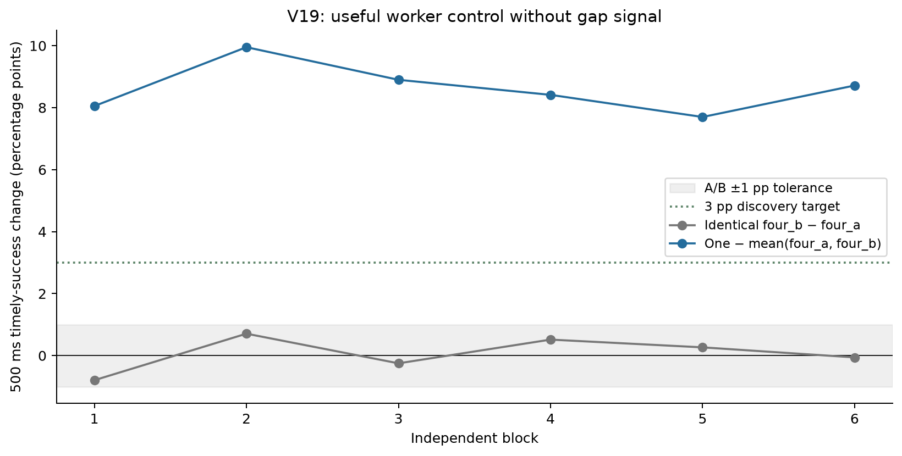

# V19 worker-control discovery

**Decision: useful_worker_control_without_gap_signal**

Six independent blocks are a discovery study, not confirmation or equivalence. Completion precedes bookkeeping/publication; handler runnable readiness remains unobserved. No kernel observation or scheduler-only causal attribution is made.

Primary: timely successful responses by 500 ms / all offers. Failed and dropped offers remain in requests.csv.

| Block | A/B delta (pp) | One minus mean(A,B) (pp) | A/B screen | Guardrails |
|---|---:|---:|---|---|
| 1 | -0.795 | 8.052 | True | True |
| 2 | 0.707 | 9.951 | True | True |
| 3 | -0.250 | 8.899 | True | True |
| 4 | 0.515 | 8.413 | True | True |
| 5 | 0.265 | 7.699 | True | True |
| 6 | -0.059 | 8.715 | True | True |

The independent verifier checks raw joins, exports, decision rules and all sealed attempt references.

Interrupted blocks: []

