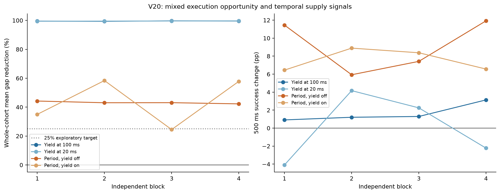

# V20 execution-delay factorial probe

**Decision: mixed_execution_opportunity_and_temporal_supply_signals**

Four independent blocks are an exploratory factorial probe, not confirmation or equivalence. Next-job starts bound prior publication only because there is exactly one worker. Exact publication, handler runnable readiness and CPU availability remain unobserved. Neither factor identifies an exclusive cause or proves a scheduler defect. No A/A arm or kernel observation is included; V19 repeatability does not qualify V20.

Mechanism primary: completion-to-resume mean across all offered requests, assessable only with complete timing coverage.
All offers remain in requests.csv. Unknown next-start publication bounds are never zero delay.

| Block | Yield at 100 ms: gap reduction | Yield at 20 ms: gap reduction | Period without yield: gap reduction | Period with yield: gap reduction | Guardrails vs A |
|---|---:|---:|---:|---:|---|
| 1 | 99.50% | 99.42% | 44.21% | 34.98% | True |
| 2 | 99.34% | 99.52% | 43.03% | 58.37% | True |
| 3 | 99.69% | 99.58% | 43.08% | 24.48% | True |
| 4 | 99.56% | 99.68% | 42.26% | 57.82% | True |

The independent verifier checks raw joins, exports, decision rules and all sealed attempt references.

Interrupted blocks: []

