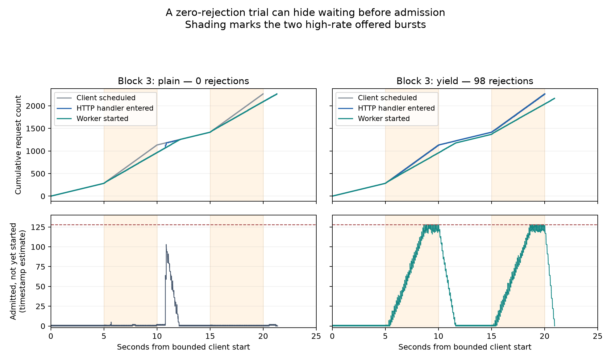

# What the saved v8 trials reveal about admission and queue saturation

Offline review — 2026-10-02. All 16 sealed trials revalidated; 36,240 client requests join uniquely to server handler entry, decision and exit events. Source snapshots and completion seals were checked. No measurement was launched; no performance gate was changed.

## Finding: lower rejection can conceal waiting before admission

Yielding sharply reduces the time from the client schedule to HTTP handler entry in every balanced block, with tracing off and on. The non-yielding queue often stays almost empty through much of the offered high-rate half, then jumps near its limit as handlers catch up. Yielded queues instead grow throughout the high-rate half. This supports admission spreading as a substantial contributor to the lower rejection of the non-yielding baseline.

The table reports medians of four per-trial values, not pooled percentiles. Entry delay includes all offered requests; queue wait includes admitted work only.

| Mode | p99 schedule → handler entry | p50 queue wait | High-phase requests entering after their burst, per trial | Backlog-window completions/s |
|---|---:|---:|---:|---:|
| plain | 3732.320 ms | 0.003 ms | 186.0 | 135.23 |
| trace | 2112.292 ms | 0.007 ms | 46.0 | 134.72 |
| yield | 88.971 ms | 352.968 ms | 22.5 | 133.88 |
| yield_trace | 89.411 ms | 353.863 ms | 14.0 | 133.58 |

The clearest counterexample to interpreting rejection alone is block 3 plain: **0 rejections**, but **332** requests offered in high-rate halves enter after their own burst ends, and schedule-to-entry p99 is **3.533 seconds**. The timestamp queue estimate peaks at 103. This trial does not show that the offered burst fits the work queue when HTTP admission is responsive.



## Finding: yielded bursts outpace worker starts

Each high half offers 849 requests in five seconds. In yielded cells, 667–685 worker starts occur during each aligned high window, while 834–847 handler entries occur. The queue ends those windows with an estimated 118–126 admitted-but-not-started jobs. Rejection follows the resulting pressure on the 128-job channel. Small boundary ambiguity is documented below.

A useful conservation calculation is admissions minus worker starts equals growth in admitted-but-not-started work. Do not substitute successful throughput over the full trial for busy-window worker capacity. Rejected requests never start CPU work, and requests still waiting before the handler are absent from the channel queue.

## Finding: worker-capacity change is modest in the observed windows

Across the 100 ms bins with sustained backlog, observed completion rates are about 133–136 jobs/s. Yielding is 0.20–1.95 jobs/s lower than plain and 0.18–2.70 jobs/s lower than trace within blocks. These are descriptive comparisons of different selected windows, not proof of a causal capacity penalty. The large change in admission timing cannot be reduced to a large CPU-cost increase. A small scheduling cost could still contribute.

`capacity_sensitivity.csv` repeats this calculation using 50, 100, 200 and 500 ms bins, low/mid/high clock offsets, and backlog thresholds 8 and 16. A bin is included only if the timestamp queue estimate remains above the threshold throughout. Results without eligible bins remain unavailable. The threshold 8 allows for four dequeue-to-start gaps and one pre-send sample: the channel still has backlog under those timing bounds.

CPU/job from the entire trial is not CPU/job specifically during these busy windows; dividing the nominal quota by the whole-trial CPU/job does not measure actual burst capacity.

## What the retained runtime traces add

For traced cells, we intersect the HTTP connection goroutine scheduler states with a conservative interval from the latest possible client request-write callback to server handler entry. The request-write callback records client progress; it does not timestamp physical arrival of bytes at the server.

| Traced mode | Runnable | Sync/other wait | Network wait | Not yet created/ended |
|---|---:|---:|---:|---:|
| trace | 54.12% | 26.44% | 3.52% | 15.90% |
| yield_trace | 23.23% | 0.14% | 73.38% | 2.94% |

These are shares of summed, overlapping request intervals, not CPU utilization. Their denominators differ between modes. The connection goroutine often exists and is Runnable during non-yielded pre-handler delay; some intervals occur before that goroutine is created. The exact runtime/netpoll/accept cause remains unresolved. A network-wait state does not by itself demonstrate a slow network.

The ledger also checks whether a reused request was written during the previous request's server cleanup on the same connection. That direct overlap accounts for only part of the pre-handler delay. Cleanup starvation alone is an incomplete explanation of all delayed admission.

## How clock alignment and queue estimates were checked

For each request, client dispatch must precede the server handler-entry mark, which must precede the client first response byte. If server time equals client time plus a constant offset, each request bounds that offset. Intersecting all 2,265 request brackets gives a nonempty interval in every trial. Its width is 0.101–0.135 ms in 15 trials and 3.089 ms in block 3 plain. This is causal bracketing under a constant-offset assumption, not an independently synchronized timestamp. WroteRequest callbacks are not used as an entry ordering constraint.

Delay percentiles retain lower/upper bounds in `trials.csv`. Burst spill counts retain definite/possible classifications in `bursts.csv`; six requests in block 4 trace straddle the burst boundary under those bounds. The large seconds-long delays and the within-block yielding effect survive this uncertainty.

`admission_ns` precedes channel send; `worker_start_ns` follows dequeue; decision marks follow the decision and mutex unlock. The difference of cumulative admissions and starts is therefore an estimate of unstarted admitted work, not exact instantaneous channel occupancy. Two trials reach 129 in that estimate despite channel capacity 128; these values are retained, not clamped. Processing-interval counts stay within four workers, and all reconstructed work drains to zero. Every rejection has a capacity-sized estimate somewhere between its handler entry and rejection mark; this supports consistency with the server's full-queue rejection, not exact decision timestamps.

## Verdict and the next question

- **Admission spreading: supported.** The non-yielding cells delay handler entry, spread some high-phase work beyond the burst, and keep much waiting outside the bounded work queue.
- **Burst pressure on the yielded queue: supported.** Responsive admission delivers more work than workers start during the high halves, exhausting the finite queue.
- **Large worker-capacity collapse: weakened.** Busy-window rates are similar, although a modest penalty and selection effects remain possible.
- **Exact scheduler/accept/netpoll cause and a transparent instrumentation fix: unresolved.** Tracing-off cells have no runtime scheduler record; all four v8 modes retain custom recording and base timing.

The next retained-data step is to inspect the longest pre-handler Runnable spans and the accept-loop/connection-reader wakeup stacks, then compare how many CPU jobs complete while the HTTP goroutine is ready. If those retained events cannot locate the perturbation, plan a narrowly targeted diagnostic for that gap. Keep yielding a mechanism probe. A candidate still needs a fresh qualification at the original workload and failure/overhead gates before full collection.

## Reproduction and artifacts

Run from the repository root, choosing a fresh output directory:

```bash
MPLCONFIGDIR=/tmp/cpu-quota-mpl venv/bin/python diagnostic/inspect_yield_queue.py \
  results/diagnostic/runtime-io-v8-yield-1 \
  --output analysis/runtime_io_v8_queue_fresh
```

Outputs: `request_ledger.csv`, `trials.csv`, `bursts.csv`, `contrasts.csv`, cumulative/count timelines at 10/50/100 ms, `capacity_sensitivity.csv`, `summary.json`, `validation.json`, `source_hashes.json` and PNG/PDF figures. The analyzer refuses to overwrite an existing output or write into the retained session. The six new tests cover clock bounds, dispatch origins, inconsistent alignment, ID zero/duplicates, conservation, handoff estimates and half-open bin boundaries. All 50 diagnostic tests passed.

Frozen load-generator source and its recorded binary seal are retained; the collector did not snapshot the executable itself. This analysis does not claim to rehash a nonexistent frozen binary. Individual sealed trial files were rehashed by the existing validator.
