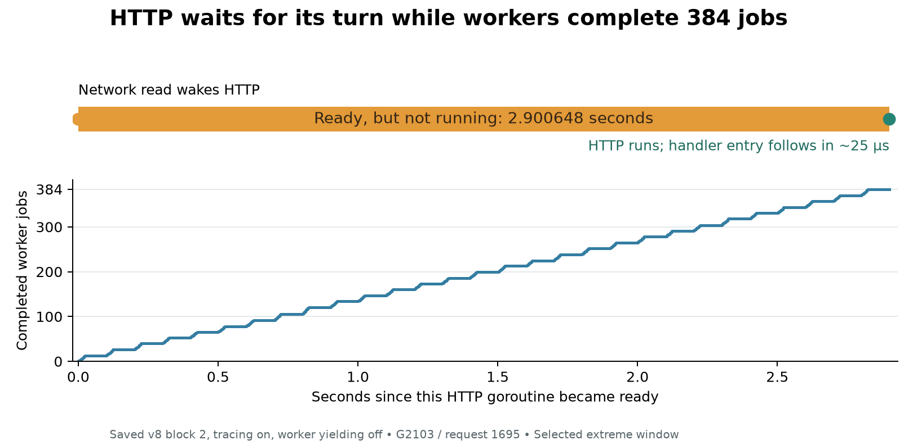

# Step 1: what happens during the saved long HTTP waits

Date: 2026-10-02. Offline inspection of the completed v8 worker-yield study.
No service change or new performance measurement was made.

2026-10-03 timestamp audit: all eight selected ready-wait durations and worker
completion counts survive reconstruction from the decoder's original event
timestamps. Same-P handoff counts also survive. One worker-admission cohort p99
changes by 64 ns; its table below is corrected. The previously reported
generation `Sync` proximity to worker preemption does **not** survive and must
not be used as causal timing evidence. See the
[corrected investigation](../analysis/runtime_io_v9_investigation_20261003_final/report.md).

## Finding in plain language

HTTP code is ready to continue, but the scheduler repeatedly gives turns to
other work. Workers complete jobs, wake their waiting HTTP handlers, and those
handlers can hand the workers more jobs. Meanwhile, some HTTP goroutines that
have just become ready from a network read wait seconds for their first turn.

The strongest saved example is request 1695 on connection 251 in
`yield_b2_trace`. Its HTTP goroutine, G2103, remains Runnable for **2.900648
seconds**, during which workers complete **384 jobs**. After G2103 finally starts
running, it enters the handler within **24.801–25.513 microseconds**. The long
delay is before handler execution, rather than slow handler parsing or job
execution in that request.

This localizes a mechanism relevant to the paper: application admission itself
can be delayed by scheduling under the constrained workload. The previous queue
analysis showed how delayed admission spreads bursts and changes rejection.
These raw events explain where that admission delay occurs. They do not yet
identify a qualified correction or explain all results across quota periods.

## Scope and evidence checks

- Inspect one previously selected extreme pre-handler readiness span in each of
  the eight runtime-traced trials: four without worker yielding and four with it.
- Decode the saved `runtime.trace` files with the trace tool built from the exact
  retained Go 1.26.1 compiler image. Each decoded scheduler dataset matches its
  sealed `trace_scheduler.json` exactly.
- Revalidate each complete trial, its frozen source provenance and the earlier
  readiness analysis's consumed-file hashes. Worker identities come from each
  trial, not fixed goroutine numbers.
- Measure readiness directly between raw `Waiting -> Runnable` and
  `Runnable -> Running` events in one runtime clock. Ignore generation census
  snapshots such as `Runnable -> Runnable`; they do not reset the wait.
- Match worker completion timestamps using the saved runtime/service clock
  bounds. Certain and possible completion counts agree for all eight windows.
- For wakeup cohorts, include actual `Waiting -> Runnable` wakes in the selected
  half-open window and follow them to their first run, even after the window.
  None remain unresolved. Preemptions are a separate category.

These are selected extreme windows, not whole-trial latency distributions or
independent repetitions of one identical arrival window. The trace-off trials
have no equivalent scheduler event stream.

## The event sequence repeats across all four blocks

| Block | Ready wait without yield (ms) | Jobs completed during wait | Ready wait with yield (ms) | Jobs completed during wait |
|---|---:|---:|---:|---:|
| 1 | 2320.715 | 314 | 88.466 | 7 |
| 2 | 2900.648 | 384 | 88.379 | 8 |
| 3 | 2208.931 | 298 | 86.852 | 6 |
| 4 | 2611.479 | 356 | 85.930 | 6 |

In every selected span:

1. The HTTP goroutine was waiting in a network read. Its stack leads through
   `internal/poll.(*FD).Read`, `main.(*trackedConn).Read`,
   `net/http.(*connReader).Read`, and `bufio.(*Reader).Peek` inside
   `net/http.(*conn).serve`.
2. It becomes Runnable in an event recorded with `P=-1` and actor `G=-1`.
   Here, P means a Go execution resource; this context has no active P. The
   event does not retain an actor stack, so it does not prove which runtime
   component performed the wakeup.
3. Other work keeps running while this HTTP goroutine remains Runnable.
4. Once it runs, handler entry follows in roughly **9–31 microseconds**.

The prior request's cleanup on the same connection had already finished before
the selected readiness span. The span also cannot be a goroutine blocked on a
recorder mutex: throughout this interval it is Runnable, awaiting execution.
Recorder effects elsewhere in the workload remain possible.

The full raw block-3 yielded span is 86.852288 ms. The earlier readiness report
clipped its start to an inspection boundary and reported 86.838996 ms. This
report uses the actual raw wakeup for all eight spans.

## Different kinds of ready work receive very different turns

During the block-2 non-yielded long wait, distinguish wakes by their prior wait
and the actor's stack:

| Wakeup cohort | Count | Median ready-to-run delay | p99 delay (ms) | Maximum (ms) |
|---|---:|---:|---:|---:|
| Handler admission wakes worker | 385 | 1.728 microseconds | 0.004352 | 491.835 |
| Worker reply wakes HTTP handler | 384 | 0.832 microseconds | 490.757 | 493.750 |
| Network read wakes HTTP, no active P | 129 | 1621.217 milliseconds | 2800.737 | 2900.648 |

Channel handoffs are usually fast, but they also have substantial outliers.
Do not describe every channel wakeup as immediately served.

The other three non-yielded windows show the same median contrast: network-read
wakes wait approximately 0.924–2.000 seconds, while worker-reply wakes wait
0.704–0.768 microseconds. Listener wakeups also wait 1.821 and 2.012 seconds in
blocks 3 and 4. The delay can therefore affect accepting connections as well as
reading the next request on an existing connection.

In the yielded extreme windows, network-read cohort medians are 2.833–6.334 ms,
although their selected longest waits remain approximately 86–88 ms. The
comparison supports an effect on scheduling opportunity; it does not establish
that yielding is an acceptable final solution. Rejection and queue growth from
the completed study remain part of the result.

## Leading explanation from the pinned runtime source

The observed worker/handler feedback is consistent with local channel wakeups
receiving a `runnext` preference while network-ready work waits in the global
runnable queue:

- Channel send/receive paths call `goready`; this calls `ready` with `next=true`
  ([proc.go](../analysis/runtime_io_v8_long_waits/go_source/runtime/proc.go),
  lines 481 and 1120; [chan.go](../analysis/runtime_io_v8_long_waits/go_source/runtime/chan.go),
  lines 350, 484 and 745).
- `runqput` can place that goroutine in the local `runnext` slot. `runqget` then
  runs it with an inherited time slice. The source explicitly discusses
  starvation from repeated handoffs and reliance on sysmon preemption
  (`proc.go`, lines 7478 and 7599).
- A network-ready list injected without a P is placed in the global queue
  (`injectglist`, line 4045; no-P branch at 4089). The observed no-P network
  wakeups are consistent with this path, but their missing actor stacks prevent
  definitive attribution to it.
- `findRunnable` checks global work for fairness every 61 scheduler ticks, then
  otherwise takes local work before global work (line 3443). `execute` increments
  the tick when a time slice is not inherited (line 3350). Repeated inherited
  handoffs can therefore make many completed jobs an unreliable proxy for many
  fresh scheduling ticks.
- `Gosched` moves the yielding goroutine onto the global runnable queue and
  schedules other work (`goschedImpl`, line 4307). That is a source-level reason
  why the existing yield probe could interrupt the feedback.

**Inference, not a proved queue history:** the trace records goroutine states
and stacks, but not the precise `runnext` contents, local/global placement or
per-P scheduler tick values. We have not proved why the usual fairness and
preemption mechanisms fail to bound these waits under this workload.

Workers repeatedly block on their work channel and are woken again during the
long spans. This is not evidence that a single worker runs uninterrupted for
multiple seconds. Go Running state also includes possible OS descheduling;
it is not a CPU-time measurement.



## A specific tracer interaction to examine in step 2

Each selected non-yielded window contains exactly three recorded worker
preemptions, for 12 total. In all 12 cases, an identified trace-advancer
goroutine starts running **45–84 microseconds before** the worker preemption.
The prior decoded stream placed generation `Sync` events close after these
preemptions. The 2026-10-03 original-timestamp audit shows that this proximity
was affected by the decoder's monotonic timestamp adjustment. That association
is withdrawn. The 45–84 microsecond trace-advancer start association survives;
it does not establish which signal caused an individual preemption.

The pinned source supplies a concrete connection: the trace advancer normally
advances generations about once per second (`trace.go`, lines 1097–1125).
`traceAdvance` calls `forEachP` to obtain processor status (lines 557–570), and
`forEachPInternal` calls `preemptall` (`proc.go`, lines 2111–2203).

Thus tracing can change scheduling through periodic maintenance, beyond merely
adding event-writing cost. The event timing strongly associates these selected
preemptions with maintenance, but the events do not identify the causal signal.
This does not prove that tracing creates the original long wait: substantial
delays also occur with runtime tracing off in the completed study. It raises a
specific possibility that tracing changes how often the scheduling feedback is
interrupted. Disabling tracing has not been shown to be a correction.

## What step 1 resolves, and what remains

**Resolved:** the saved extreme waits include actual runnable HTTP goroutines
waiting for execution before handler admission, while worker completion and
channel handoffs continue. The distinction between network wakeups and channel
wakeups recurs across all four traced non-yielded blocks.

**Narrowed:** examine local channel handoff preference, global network-ready
work, and periodic trace maintenance/preemption together. The retained source
and timing support this mechanism, but do not yet establish its complete cause.

**Still open:** exact queue placement; per-P scheduler tick progression; the
origin and effectiveness of individual preemption requests; kernel execution
and throttling alignment; how this mechanism changes across quota periods; and
a correction that passes the original delay, rejection and throughput rules.

This is diagnostic support for the paper's analytic mechanism, at one quota and
worker configuration. A solution claim still needs steps 2 and 3. The original
workload, queue size and acceptance rules remain the basis for that test.

## Reproduction and artifacts

From the repository root, after producing the eight decoded dumps using the
pinned compiler's `go tool trace -d=parsed`:

```bash
venv/bin/python diagnostic/inspect_long_wait_events.py \
  results/diagnostic/runtime-io-v8-yield-1 \
  --examples analysis/runtime_io_v8_queue_review/prehandler_ready/examples.json \
  --dumps analysis/runtime_io_v8_long_waits \
  --decoder analysis/runtime_io_v8_long_waits/go-trace \
  --output analysis/runtime_io_v8_long_waits/fresh_review
```

- [Raw event analyzer](../diagnostic/inspect_long_wait_events.py)
- [Analyzer tests](../diagnostic/test_long_wait_events.py)
- [Verified summary and raw boundary evidence](../analysis/runtime_io_v8_long_waits/review_final/summary.json)
- [Matched wakeup ledger](../analysis/runtime_io_v8_long_waits/review_final/wakeups.csv)
- [Provenance hashes](../analysis/runtime_io_v8_long_waits/review_final/source_hashes.json)
- [Validation](../analysis/runtime_io_v8_long_waits/review_final/validation.json)
- [Illustration and pinned runtime-source hashes](../analysis/runtime_io_v8_long_waits/review_final/illustration_source_hashes.json)
- [Prior admission and queue analysis](runtime_io_v8_queue_findings.md)

The outputs are derived evidence outside the sealed session. They remain
`eligible_for_full=false`; they do not grant full-collection qualification.
