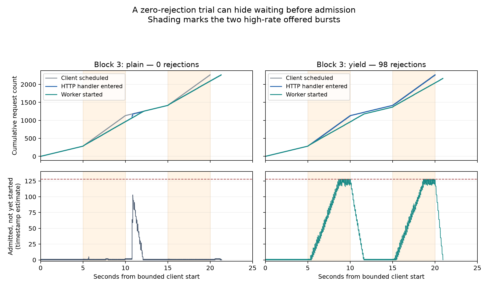

# New discoveries from the saved v8 trials — 2026-10-02

We completed the first two routes in the investigation map: reconstructing
admission/queue behavior and testing admission spreading against burst capacity.
We also inspected the longest retained pre-handler Runnable spans. No new
performance workload was launched and the qualification gates remain unchanged.

## The main discovery: low rejection was hiding waiting before admission

All 16 sealed trials revalidated. All 36,240 requests joined uniquely to handler
entry, admission/rejection and handler exit, including ID zero and failed
admissions. Frozen sources and individual attempt file hashes were checked.

| Mode | Median trial p99 schedule-to-handler-entry delay | Median trial p50 admitted queue wait | Median high-phase requests entering after their own burst, per trial |
|---|---:|---:|---:|
| plain | 3,732.320 ms | 0.003 ms | 186 |
| trace | 2,112.292 ms | 0.007 ms | 46 |
| yield | 88.971 ms | 352.968 ms | 22.5 |
| yield_trace | 89.411 ms | 353.863 ms | 14 |

These are medians of four per-trial statistics, not pooled percentiles. Entry
delay uses every offered request; queue wait uses admitted jobs. Separate
percentiles must not be added into a synthetic request latency.

Yielding reduces handler-entry p99 in every block, both with and without runtime
tracing. Without yielding, the queue often remains nearly empty through much of
the offered burst and then jumps near capacity as delayed handlers catch up.
With yielding, it grows throughout the burst and reaches its limit.

The strongest example is **block 3 plain**: no requests were rejected, but **332
high-phase requests entered after their own burst ended**, and handler-entry p99
was **3.53 seconds**. Its queue estimate peaked at 103. Much waiting remained
before the queue rather than being accounted for by its occupancy.

In the top panels, handler entry counts include rejected requests; worker-start
counts exclude them. The bottom panels show admitted-but-not-started work. The
shaded regions mark the offered high-rate halves. This is one illustrative
block; the complete review plots every block and mode.

## Why the yielded queue still rejects work

Each five-second high half offers 849 requests. In the yielded trials, workers
start 667–685 jobs during those aligned windows while 834–847 handlers enter.
The 128-job queue cannot absorb that difference indefinitely. It ends the high
halves with an estimated 118–126 waiting jobs, and every yielded trial rejects
some requests once the queue fills.

This supports the explanation that improved HTTP responsiveness exposes burst
pressure sooner. It does not show that yielding is an overall fix: rejection
still occurs and successful latency has the previously reported tradeoff.

## A second discovery: ready HTTP work waits while CPU jobs keep finishing

The longest pre-handler HTTP Runnable spans in the four non-yielding traced
cells are **2.21–2.90 seconds**, while **298–384 other jobs complete** during
those spans. In all four examples, the previous request's server cleanup on the
same reused connection had already finished before the Runnable span began.

With yielding, the longest corresponding spans are **85.93–88.47 ms**, with
**6–8 other job completions**. This provides direct scheduler evidence for an
additional scheduling delay before handler entry, beyond the previous-request
cleanup dependency. Ready-to-run HTTP work and continuing CPU job completion
coexist in the non-yielding treatment.

These observations do not identify the internal runtime queue or policy that
chose other work. Temporal overlap is not CPU-time attribution. Trace-off
goroutine states remain unavailable, and all v8 modes retain custom recording.

Exact request IDs, goroutine IDs, service-local span boundaries, clock uncertainty
and neighboring examples are retained in the
[ready-span report](../analysis/runtime_io_v8_queue_review/prehandler_ready/report.md)
and its `examples.json`.

## What the capacity checks do and do not establish

In 100 ms windows with sustained backlog, observed completion rates are roughly
133–136 jobs/s across the four modes. The within-block yielding differences
are small compared with the seconds-long admission delays.

We varied the window width from 50 to 500 ms, the backlog threshold from 8 to
16, and the clock offset across its full admissible bracket. Clock choice
changes these rate estimates by at most 0.187 jobs/s. Window selection matters:
in 50 ms bins, yielded traced cells can have higher rates than non-yielded traced
cells; in 100–500 ms bins the direction reverses. The data therefore do **not**
establish a causal small capacity penalty from yielding. They weaken a large
capacity-collapse explanation, while leaving modest costs and selection effects
unresolved. Whole-trial CPU/job is not busy-window CPU/job.

## Timing limits and checks

We bounded the client/service clock offset using every request's causal order:
client dispatch precedes handler entry, which precedes the first response byte.
Under a constant-offset assumption, the bracket width is 0.101–0.135 ms in 15
trials and 3.089 ms in block 3 plain. This is causal bracketing, not independent
clock synchronization. Large delay differences survive those bounds; six
requests in block 4 trace have ambiguous burst-boundary membership.

Admission is sampled before channel send and worker start after dequeue. Thus
cumulative admissions minus starts estimates admitted-but-not-started work,
including handoff gaps; it is not exact instantaneous channel occupancy. Two
trials reach 129 in that estimate despite capacity 128, and those values are
preserved. All reconstructed work drains to zero; overlapping processing
intervals remain within four workers. Every rejection has a capacity-sized
estimate within its entry-to-rejection-mark interval. Connection reads are not
silently treated as individually framed requests.

The ready-span analysis uses a conservative interval from the latest possible
client request-write callback to handler entry, with a separately recorded
runtime/service clock mapping. A client write callback does not establish
physical arrival at the server. Same-state scheduler generation snapshots do
not split one continuous Runnable span into artificial wakeups.

## Where the investigation goes next

The question has narrowed from "why is latency high?" to **why does ready HTTP
connection work wait for seconds while workers continue taking CPU jobs under
the non-yielding treatment?**

Inspect the retained raw trace wakeup/enqueue context and stacks at the saved
longest-span boundaries. Include the accept-loop goroutine for delays before a
connection handler exists. Those details are not present in the simplified
scheduler JSON, so the current review cannot identify an exact tracing call to
patch. Use this evidence to select a targeted diagnostic only if the retained
raw events cannot distinguish the alternatives.

The original workload and qualification gates remain the acceptance target.
Yielding changes service scheduling and stays a mechanism probe. A transparent
instrumentation candidate still needs a separately planned fresh qualification
before the full matrix.

## Reproduction and verification

- [Full queue review and reproduction](../analysis/runtime_io_v8_queue_review/report.md)
- [All-request ledger](../analysis/runtime_io_v8_queue_review/request_ledger.csv)
- [Burst summaries](../analysis/runtime_io_v8_queue_review/bursts.csv)
- [Capacity sensitivity](../analysis/runtime_io_v8_queue_review/capacity_sensitivity.csv)
- [Ready-span report and reproduction](../analysis/runtime_io_v8_queue_review/prehandler_ready/report.md)
- [Validation and retained source hashes](../analysis/runtime_io_v8_queue_review/validation.json)
- [Queue analyzer](../diagnostic/inspect_yield_queue.py)
- [Ready-span analyzer](../diagnostic/inspect_prehandler_ready.py)

All **52 diagnostic tests passed**, including eight new checks for clock
bracketing, request ID zero/duplicates, conservation, handoff estimates,
half-open event bins and continuous Runnable spans. Figures were visually
inspected. The first exploratory output is retained separately under
`analysis/runtime_io_v8_queue_20261002`; the linked review includes the final
figures, sensitivity checks and interpretation.
