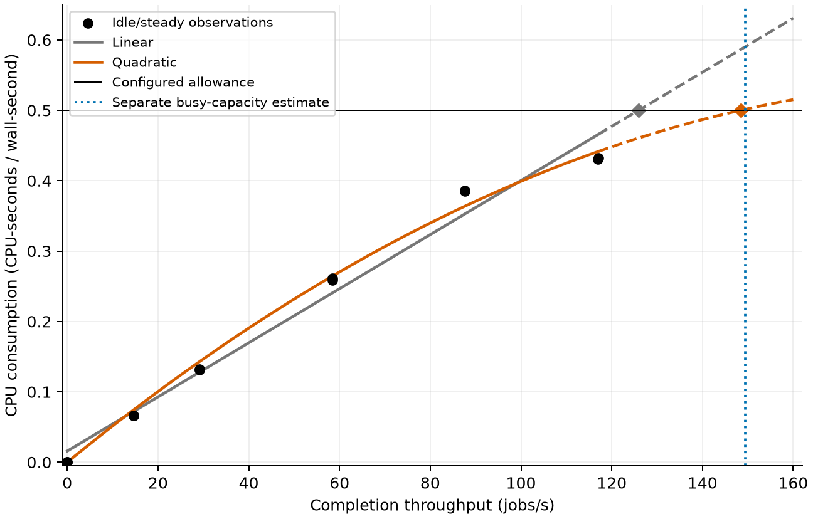
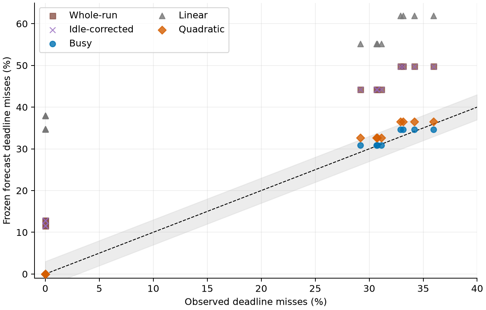

# Capacity Calibration and Deadline Forecasts Under a Fractional CPU Quota

## Abstract

Can whole-run CPU per completed job be substituted for busy service capacity
when forecasting deadline misses in a quota-limited service? We compare five
independently calibrated capacity inputs within one finite FIFO forecasting
model for a Go HTTP service limited to 50 ms of CPU per 100 ms. Predictions
are frozen before sixteen fresh validation trials, and the endpoint is the
fraction of all offered requests that fail a 500 ms deadline. Mean absolute
forecast error is 13.494 percentage points for nominal allowance divided by
whole-run CPU/job and 13.471 after direct idle correction, compared with 0.453
for backlogged-window throughput. A quadratic utilization–throughput benchmark
achieves 1.169 points, substantially narrowing the advantage of busy
calibration; a linear fit achieves 31.314. Busy calibration passes all declared
accuracy checks, but its advantage over quadratic does not meet the predefined
minimum-effect screen. Earlier prospective validation covers two SHA work
sizes and two burst timescales. The contribution is a reproducible case showing
how capacity calibration affects deadline forecasts, including a
nonlinear alternative that approaches busy accuracy. The study establishes
neither a new estimator nor general superiority over CPU-based methods.

## 1. Research question and contribution

We ask one question: **in this quota-limited service, how accurately do
independently calibrated whole-run, busy-window and nonlinear CPU-based
capacity estimates forecast all-offer 500 ms deadline misses?**

The tested whole-run substitution divides the configured CPU allowance by
aggregate CPU per completed job. Its measurement cohort spans varying load
and final drain. Busy calibration instead measures completion throughput in
fixed windows while work is queued. These measurements need not represent
the same operating condition. Their disagreement matters when a capacity
estimate is used to forecast queues near sustained overload.

Our empirical contribution is the prospective comparison of these inputs
within a shared forecasting model. The declared whole-run substitution
underestimates busy capacity and substantially overpredicts deadline misses.
Direct zero-request CPU correction barely changes the result. Crucially, a
nonlinear CPU-based benchmark predicts nearly the same capacity as busy
calibration. This bounds the lesson: the demonstrated failure concerns the
particular aggregate substitution, rather than CPU-based estimation as a class.

The FIFO model, busy calibration and load-dependent estimation are established
building blocks. We do not establish that practitioners universally use the
tested substitution, identify the mechanism of its error, or propose a new
estimator. The principal comparison is the final independently calibrated
study, identified as V28 in the artifact; earlier prospective studies support
its context. Technical qualification and unsuccessful investigations are
documented separately rather than counted as additional contributions.

## 2. Prospective comparison

### 2.1 Service, resource contract and endpoint

The containerized Go service uses one worker, `GOMAXPROCS=1`, a waiting queue
of 128 jobs and yielding disabled. CPU allowance is 50 ms per 100 ms with
zero burst credit (`cpu.max=50000 100000`, `cpu.max.burst=0`). The Linux
CPU controller defines a bandwidth ceiling [1]. The recorded service uses
stock Go 1.26.1 on Linux 7.2.8-arch1-2; the host records `amd-pstate-epp`
with the `powersave` governor and `balance_performance` preference. Frequency
is not fixed, and these settings do not isolate a frequency-related cause. The service uses CPUs 2 and 4; the client/controller uses
CPUs 0 and 1. Host power, resource limits, schedules, application identities,
kernel and boot identities are retained and checked. Affinity and checks do
not establish exclusive CPU service or absence of host interference.

Work is repeated SHA computation: 44,000 iterations per small job and 88,000
per large job. Earlier work-size validation uses both sizes; the final
comparison uses the small-job service. All studies use one application, one
host and one quota. Work-size transfer is not independent application transfer.

Every calibrated capacity feeds the same initially empty constant-service
FIFO model with one active job, 128 waiting slots and exact offered timestamps.
The model omits entry delays, runtime/HTTP effects and quota pulses. The
deadline starts at the scheduled offer; unsuccessful offers count as misses
in the full offered cohort. Thus the comparison concerns capacity inputs
within a fixed model, rather than successful-request latency alone or a new
queueing method.

### 2.2 Capacity inputs and calibration data

Let `q = 0.5` CPU-seconds per wall-second, `C` be cgroup CPU use, `N` the
completed-job count and `T` the enclosing measurement-through-drain duration.
The two direct estimates are:

```text
c_whole = C / N
mu_whole = q / mean(c_whole)
mu_busy = mean(completions / window duration in eligible backlogged windows)
```

Means use the declared independent calibration trials. CPU/job is computed
separately per mixed run before averaging; the estimator is not a pooled
CPU/count ratio. Warm-up CPU is excluded. Each slot has 20 s warm-up at its
low rate, then full drain and a metrics reset before measurement. Idle and
steady measurement lasts 30 s. The four mixed calibration runs last 60 s:
four 15 s cycles with 10 s at 15 or 30 jobs/s and 5 s at 169.8 jobs/s.
Whole-run CPU and wall time include measurement startup, terminal control
and final drain. Mixed busy windows are [11.5,14.5) s plus 15 s per cycle. Busy eligibility
requires a guaranteed positive waiting queue throughout clock-expanded fixed
windows in the final comparison. Accounting brackets bound counts and
durations; they are distinct from statistical intervals. Earlier studies
use their own frozen eligibility definitions, retained in the supplement.

V28 uses four mixed calibration trials for the whole and busy estimates,
plus twelve idle/steady observations: two balanced blocks at zero requests
and steady offered rates 15/30/60/90/120 jobs/s. The idle/steady observations
provide data for CPU-based regression; dedicated zero-request observations
measure background rate `b_idle` for the additive correction.

```text
mu_idle = (q - b_idle) / mean((C - b_idle*T) / N)
U = C / T; X = N / T
linear:    U(X) = b + d*X
quadratic: U(X) = b + d*X + e*X^2
regression capacity: admissible root of U(X) = q
```

The regressions minimize equal-run CPU-utilization residuals with a
nonnegative intercept, positive initial slope, bounded extrapolation and
declared monotonicity checks. The capacity root must not exceed twice the
maximum measured calibration throughput. The linear fit has intercept
0.0158658 CPU and slope 0.00384378 CPU-seconds/job. The selected quadratic
fit is `U(X)=0.005276096 X - 0.000012853378 X²`, with CPU/wall-second units.
Its root is 1.269 times the maximum measured throughput of 117.029 jobs/s;
the result involves extrapolation. Quadratic fitting compares a finite candidate
family including free and zero intercept and the linear boundary. The selected
quadratic intercept is zero. This is a declared nonlinear benchmark, not a
reproduction of a published queueing-constrained estimator. Loaded-background
additivity is an assumption of the idle correction.



**Figure 1.** Twelve independent idle/steady observations and the retained
linear and quadratic fits. Dashed portions extend beyond the measured
throughput range. Diamonds mark roots at 0.5 CPU. The vertical line is the
separate mixed-run busy estimate; it is not a fitting constraint. No uncertainty
band is inferred from this descriptive plot.

The calibration budgets differ: the direct estimates use four mixed runs,
whereas regression uses twelve idle/steady observations. The study does not
establish an advantage at equal calibration cost, a minimum measurement budget
or accuracy from unmeasured workloads.

### 2.3 Fresh validation and frozen criteria

The final study contains sixteen calibration slots, a forecast freeze, then
sixteen fresh sampler-off validation trials in four balanced blocks crossing
low offered rates of 15/30 jobs/s with 6/12 s burst cycles. High offered rate
is 180 jobs/s. Each validation measurement lasts 60 s; low/high phases occupy
two-thirds and one-third of each cycle. Calibration and all predictions seal
before validation; validation outcomes never fit or select a method. Warm-up and full-drain
rules also apply to validation. Busy validation windows are [4.8,5.8) s
plus 6 s per cycle, or [10,11.8) s plus 12 s per cycle; eligibility requires
a positive waiting queue throughout the clock-expanded interval. Validation
changes both the mixed calibration cycle length and its high offered rate.

The frozen per-trial accuracy tolerances are at most 3 percentage points of
deadline-miss error and 5% capacity error, the latter assessed against measured
busy-capacity bounds. The stronger advantage screen requires positive error
improvement in every block and a four-block 95% interval lower bound of at
least 1 percentage point. All sixteen trials, including zero-miss cases,
contribute. Intervals assume independent, approximately normal block
contrasts; there are four statistical blocks, not thousands of independent
request-level replicates. Deadline accuracy is the application outcome;
agreement with busy-capacity bounds is a supporting check that naturally
uses the busy measurement definition.

## 3. Prospective evidence

### 3.1 Main result: busy calibration and the nonlinear comparator

V28 completes all 32 slots without retries; all 108,084 measurement offers
and 21,600 warmup offers succeed. Every scientific run uses the native sampler
off. Forecasts seal 13.912 s before the first validation attempt. Observed
validation busy-capacity bounds span 148.667–150.500 jobs/s. This outcome
tests late successful requests; rejection handling is defined but not exercised
by failures in this final validation cohort.

| Frozen capacity input | Capacity jobs/s | Deadline MAE pp | Maximum deadline error pp | Maximum capacity error % | Deadline checks /16 | Capacity checks /16 |
|---|---:|---:|---:|---:|---:|---:|
| Whole-run CPU/job | 139.669 | 13.494 | 16.905 | 7.197 | 0 | 0 |
| Idle-corrected CPU/job | 139.743 | 13.471 | 16.810 | 7.148 | 0 | 0 |
| Busy capacity | 149.417 | 0.453 | 1.714 | 0.720 | 16 | 16 |
| Linear CPU-based fit | 125.953 | 31.314 | 37.929 | 16.311 | 0 | 0 |
| Quadratic CPU-based fit | 148.463 | 1.169 | 3.619 | 1.354 | 13 | 16 |



**Figure 2.** Frozen forecasts against all-offer outcomes in all sixteen
validation trials. The diagonal denotes exact agreement; the gray band spans
±3 percentage points, the declared deadline-error tolerance. Repeated points
overlap, including eight zero-miss trials. The band is a tolerance, not a
confidence interval. Idle-corrected forecasts nearly overlap whole-run forecasts.

Here MAE is mean absolute error across the sixteen trial miss fractions;
pp denotes percentage points. Busy meets every accuracy tolerance. Quadratic
meets all capacity tolerances and thirteen deadline tolerances. Whole,
idle-corrected and linear inputs substantially overpredict misses and fail
every accuracy check. Their errors characterize these declared fits and the
shared FIFO model, rather than CPU-based methods generally.

Busy reduces quadratic's deadline error by a mean 0.716 percentage points,
with model-based 95% interval [0.086, 1.346]. All four block improvements are
positive, but the lower endpoint fails the required 1-point minimum. Retain
`predictive_advantage_inconclusive`. The interval includes 1 point, so it
also does not establish that the true improvement is below the target.
Advantages over the other three inputs pass their frozen screens.

Both busy and quadratic predict zero misses in all eight 6 s trials. For
the eight 12 s trials, descriptive MAEs are 0.906 and 2.337 points,
respectively. That subset helps interpret the aggregate errors and does not
replace the frozen all-trial comparison. The quadratic comparator's near
agreement is a central result: a nonlinear CPU-based fit recovers most of
the forecasting accuracy lost by the tested whole-run substitution.

The additive idle correction changes estimated capacity only from 139.669
to 139.743 jobs/s. Its measured background rate is approximately 0.000261
CPU. This rejects the declared zero-request additive correction as an
adequate repair in this case, without identifying loaded overhead or its cause.

### 3.2 Earlier prospective validation

An earlier small-job study, V22, uses two calibration runs followed by eight
fresh bursty/even validation trials and four paired contrasts. Busy capacity
is 152.47 jobs/s; it predicts 10.38% burst misses against 10.97–11.92%
observed, while whole-run accounting predicts 44.05%. Even arrivals have
zero 500 ms misses despite approximately 14.8% higher whole-run CPU/job.
All twelve primary checks pass, with maximum error 1.55 percentage points.

V23 independently calibrates each work size and validates sixteen trials
in four balanced blocks crossing size and burst timescale:

| V23 job size | Burst cycle | Mean observed misses | Busy forecast | Whole-run forecast |
|---|---:|---:|---:|---:|
| Small | 3 s | 0.00% | 0.00% | 0.00% |
| Small | 12 s | 22.56% | 22.76% | 49.23% |
| Large | 3 s | 0.00% | 0.00% | 0.00% |
| Large | 12 s | 16.13% | 17.26% | 46.85% |

Each row summarizes four trials. All sixteen trial checks and eight paired
contrasts pass; maximum error is 1.83 percentage points. All 81,504 validation
offers succeed, with no responses exceeding one second. These observations
extend the prospective case across tested work sizes and burst timescales;
they do not validate a new estimator or tighter deadlines.

### 3.3 Supporting controls and retained limitations

Separate accounting studies show whole-run capacity underprediction while
eligible busy windows deliver approximately 0.5 CPU. A composition study
finds directional CPU/job changes with stable busy capacity, but its frozen
minimum-effect screen remains `composition_inconclusive`. Earlier native
sampler comparisons do not establish deadline neutrality; the main comparison
therefore uses sampler-off validation. Detailed controls, unsuccessful
qualifications and both inconclusive outcomes are retained in the supplement.
They support interpretation rather than establish an isolated causal mechanism.

## 4. Interpretation and closest methods

The case demonstrates a substantial forecast consequence of substituting a
whole-cohort CPU cost for backlogged service capacity. It also demonstrates
that nonlinear CPU-based calibration can approach direct busy accuracy.
Accordingly, the result supports attention to measurement scope and
load-dependent fits, rather than a rule to discard CPU accounting or always
choose busy throughput.

Load-dependent inference is established prior work. Kumar, Zhang and Tantawi
jointly estimate workload-dependent demand and overhead from utilization and
mean response using queueing constraints. Zhang, Li and Zhou estimate demand
as a polynomial of CPU utilization with utilization-law and soft response
constraints. Neither algorithm is reproduced here. Our quadratic fits
utilization as a function of completion throughput and supplies a capacity
root to the shared FIFO model; it uses different observations and constraints.
[2,3].

Burst-aware sizing and controlled bursty benchmark construction have
precedents [4,5]. Aggregate utilization accounting is also established in
load-dependent inference [2,3]. Reservation-based container analysis uses a CPU-service
contract different from an ordinary bandwidth ceiling. These precedents
prevent interpreting this case as a new queueing model or CPU-to-latency law.
[4–6].

Published load-dependent methods remain relevant competitors. Applying their
full algorithms requires explicit mappings for CPU units, scheduling and
response scope; the quota ratio cannot silently stand for a continuously
available processor. That adaptation requirement does not establish their
inapplicability. Their performance here is untested. The
[closest-method assessment](../docs/runtime_io_load_dependent_baseline_assessment_20261008.md)
records the comparison and its source limitations.

## 5. Scope and reproducibility

The evidence is restricted to one host, one application, one quota, two SHA
sizes and the tested deterministic schedules. Other workloads, mixed sizes,
quotas, stochastic traffic and machines are untested. The 500 ms endpoint
does not establish accuracy at other deadlines or for rare latency tails.
Aggregate CPU includes runtime, HTTP and kernel work, and phase boundaries
can contain in-flight requests. Clock/counter brackets do not prove zero
accounting lag. Frequency, cache, scheduling and loaded-overhead causes remain
unidentified. Good predictions do not independently validate the FIFO model
outside these conditions.

The study is a reproducible prospective empirical case, with a strong
nonlinear comparator and retained adverse outcomes. A new estimation method,
a general diagnostic rule and superiority over applicable published methods
remain unestablished. Further research would need a specific additional
capability and an adequate comparison; editorial restructuring supplies no
new scientific result.

Saved offers, raw events, clock/counter brackets, source/binary identities,
forecast seals and result reviews are indexed in the
[supporting material](capacity_calibration_supporting_material.md). The
[V28 protocol](../docs/runtime_io_v28_protocol.md) and
[result review](../analysis/runtime_io_v28_result_review/20261008/report.json)
retain the frozen design and checked results. These saved records support independent reproduction without performance recollection.

## 6. Conclusion

In the tested service, substituting whole-run CPU/job for busy capacity causes
substantial deadline-forecast error. A dedicated additive idle correction does
not repair that substitution. Busy calibration is accurate across the declared
prospective validation conditions, while a nonlinear CPU-only benchmark recovers
most of its accuracy. The busy-versus-quadratic advantage remains inconclusive
under the frozen minimum-effect criterion. These results support a bounded
empirical lesson: capacity calibration should be assessed against fresh deadline
outcomes and credible load-dependent alternatives. The responsible choice of
calibration outside the measured conditions remains open.

## References

1. Linux Kernel Contributors. Control Group v2: CPU controller. Linux kernel documentation. Accessed 8 October 2026. [Primary source](https://docs.kernel.org/admin-guide/cgroup-v2.html).

2. D. Kumar, L. Zhang and A. Tantawi. Enhanced Inferencing: Estimation of a Workload Dependent Performance Model. VALUETOOLS, 2009. DOI: 10.4108/ICST.VALUETOOLS2009.7799. [Primary source](https://eudl.eu/pdf/10.4108/ICST.VALUETOOLS2009.7799).

3. Z. Zhang, S. Li and J. Zhou. Estimate Load-dependent Service Demand for Modern CPU. Information Technology Journal 12(4), 632–639, 2013. DOI: 10.3923/itj.2013.632.639. [Primary source](https://scialert.net/fulltext/amp.php?doi=itj.2013.632.639).

4. N. Mi, G. Casale, L. Cherkasova and E. Smirni. Sizing multi-tier systems with temporal dependence: benchmarks and analytic models. Journal of Internet Services and Applications 1, 117–134, 2010. DOI: 10.1007/s13174-010-0012-9. [Primary source](https://link.springer.com/article/10.1007/s13174-010-0012-9).

5. G. Casale, A. Kalbasi, D. Krishnamurthy and J. Rolia. Automatic Stress Testing of Multi-Tier Systems by Dynamic Bottleneck Switch Generation. Middleware, 2009. [Primary source](https://dl.ifip.org/db/conf/middleware/middleware2009/CasaleKKR09.pdf).

6. T. Cucinotta, L. Abeni, M. Marinoni, R. Mancini and C. Vitucci. Strong Temporal Isolation Among Containers in OpenStack for NFV Services. IEEE Transactions on Cloud Computing 11(1), 763–778, 2023. DOI: 10.1109/TCC.2021.3116183. [Primary source](https://retis.santannapisa.it/people/nino/publication/TCC23.pdf).
